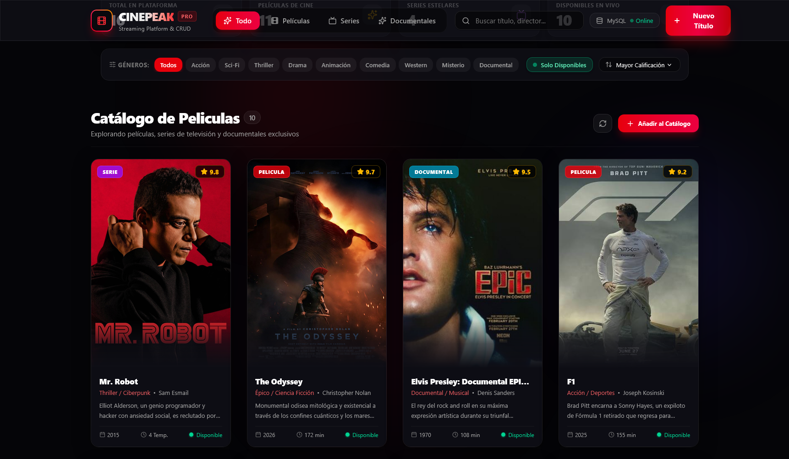
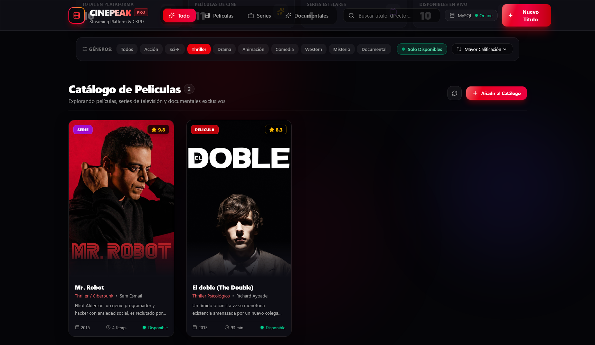
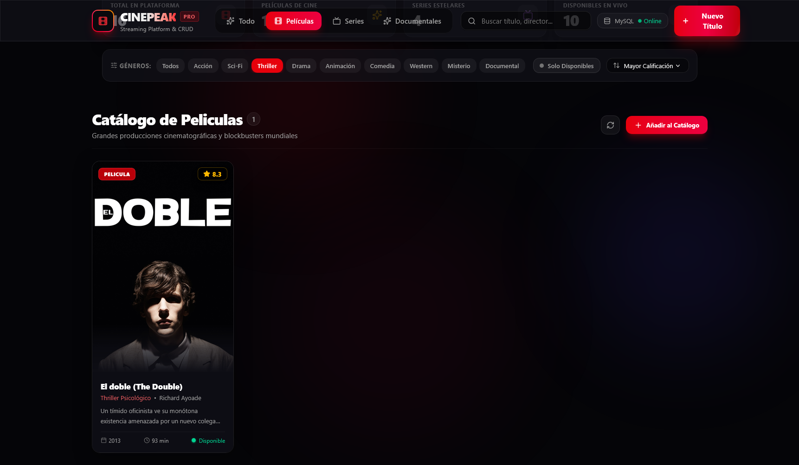
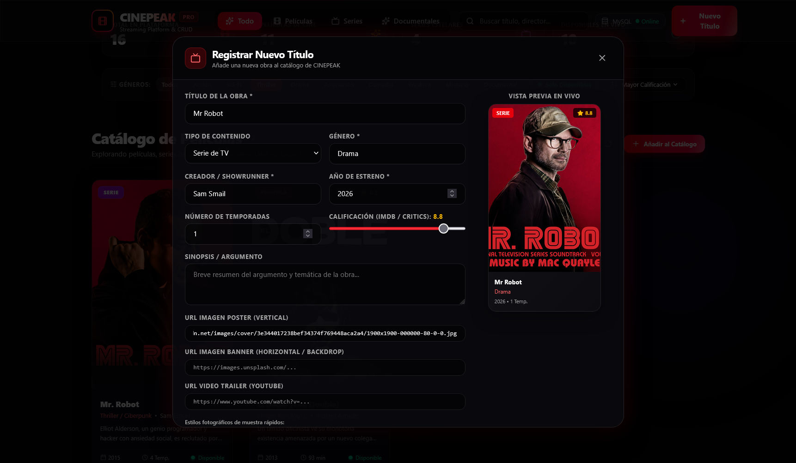
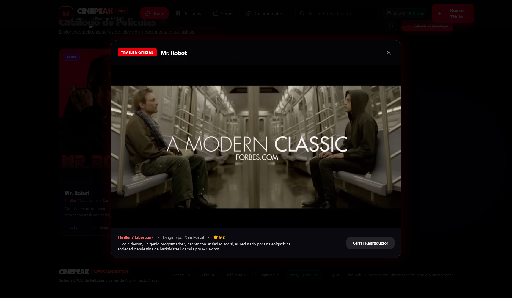

# 🎬 CinePeak - Catálogo y Gestión de Películas (CRUD)

Una aplicación web moderna y fácil de usar para explorar, filtrar y administrar películas y series en tiempo real, conectada a una base de datos MySQL.

---

## 🚀 ¿Qué hace este proyecto?

- **Catálogo interactivo:** Explora películas, series y documentales con portadas y datos completos.
- **Búsqueda y filtros rápidos:** Filtra por tipo (películas/series) y por géneros (Thriller, Acción, Drama, etc.).
- **Reproductor de tráilers:** Mira el tráiler oficial de YouTube directamente en una ventana emergente.
- **Gestión completa (CRUD):** Permite registrar nuevos títulos, editar información existente, cambiar su disponibilidad o eliminarlos.

---

## DEMO

### 1. Portada Principal (Hero Section)
Muestra visual a pantalla completa del título más destacado con reproducción directa de tráiler e información clave.


---

### 2. Catálogo Completo
Vista general con todas las películas y series registradas en el sistema.



---

### 3. Filtro por Género (Thriller)
Filtrado instantáneo que muestra únicamente los títulos del género **Thriller**.



---

### 4. Filtro Combinado (Películas + Thriller)
Filtro doble aplicado: muestra únicamente los títulos que son **Películas** y que a la vez pertenecen al género **Thriller**.



---

### 5. Formulario para Nuevo Registro
Ventana emergente para agregar una nueva película o serie con su título, director, año, póster y enlace de tráiler.



---

### 6. Detalle y Tráiler en Ventana Modal
Ventana que reproduce el tráiler oficial de la película seleccionada junto con su ficha técnica y sinopsis.



---

## INSTLACION

### Paso 1: Base de Datos (MySQL)
1. Abre tu gestor de base de datos preferido (como **XAMPP / phpMyAdmin**, **MySQL Workbench** o consola).
2. Importa o ejecuta el archivo **`database.sql`** ubicado en la carpeta principal del proyecto.
3. Esto creará automáticamente la base de datos `cine_db` y cargará los registros iniciales.

---

### Paso 2: Iniciar el Servidor (Backend)
1. Abre una terminal en la carpeta **`back`**:
   ```bash
   cd back
   ```
2. Instala las dependencias (solo la primera vez):
   ```bash
   npm install
   ```
3. Inicia el servidor:
   ```bash
   npm start
   ```
   *(El servidor quedará funcionando en `http://localhost:3000`)*.

---

### Paso 3: Iniciar la Aplicación Web (Frontend)
1. Abre una segunda terminal en la carpeta **`front`**:
   ```bash
   cd front
   ```
2. Instala las dependencias (solo la primera vez):
   ```bash
   npm install
   ```
3. Inicia la aplicación:
   ```bash
   npm run dev
   ```
4. Abre tu navegador web en la dirección que te indique la terminal (usualmente `http://localhost:5173`).

---

## 🧰 Herramientas Utilizadas

- **Frontend:** React + Vite + Tailwind CSS (Diseño visual y rapidez).
- **Backend:** Node.js con Express (Servidor que conecta la app con la base de datos).
- **Base de Datos:** MySQL (Almacenamiento seguro de toda la información).

